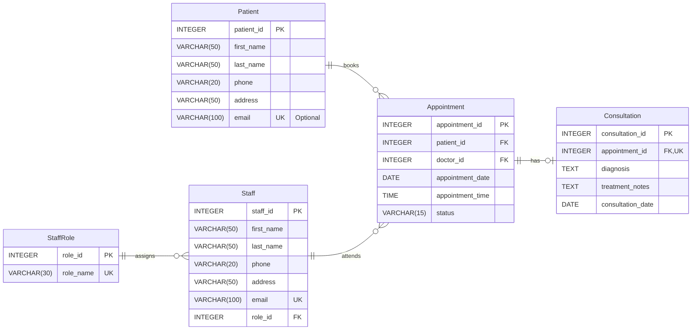

# Hospital ER Diagram

## 1. Entity Relationship Diagram

The diagram represents the five tables in the Hospital Management Database: Patient, Staff, StaffRole, Appointment and Consultation. It shows their attributes, data types, primary keys, foreign keys, unique fields and relationships.

## 2. Explanation of Keys

- **PK (Primary Key):** Uniquely identifies each record in a table. For example, `patient_id` identifies each patient.
- **FK (Foreign Key):** Links a record to an existing record in another table. For example, `patient_id` in Appointment links each appointment to a patient.
- **UK (Unique Key):** Prevents duplicate values in a field or combination of fields. For example, `role_name` must be unique, and `appointment_id` in Consultation allows only one consultation per appointment.

## 3. Explanation of Relationship Symbols

The diagram uses Crow's Foot notation to show how records relate to one another.

| Symbol | Meaning |
|---|---|
| `||` | Exactly one |
| `o|` | Zero or one |
| `o{` | Zero or many |
| `|{` | One or many |

The relationships are explained as follows:

1. **Patient to Appointment (`||--o{`):** Each appointment belongs to exactly one patient, while a patient can have zero or many appointments.
2. **Staff to Appointment (`||--o{`):** Each appointment has exactly one doctor, while a doctor can have zero or many appointments.
3. **Appointment to Consultation (`||--o|`):** Each consultation belongs to exactly one appointment, while an appointment can have zero or one consultation.
4. **StaffRole to Staff (`||--o{`):** Each staff member has exactly one role, while a role can be assigned to zero or many staff members.

## 4. Optional Fields

The `email` field in Patient is optional, but any provided email must be unique. All other Patient fields are required.

All Staff fields are required, including `email`, which must be unique. All StaffRole, Appointment and Consultation fields are also required. The foreign keys must reference existing records.

## 5. Additional Constraints and Transaction Logic

Some business rules require additional database constraints, indexes or transaction logic beyond the relationships shown in the ER diagram.

- **Valid appointment status:** A `CHECK` constraint restricts `status` to `scheduled`, `completed` or `cancelled`.
- **Doctor role validation:** Additional validation ensures that the staff member assigned as `doctor_id` has the Doctor role.
- **Appointment conflicts:** Partial unique indexes prevent a doctor or patient from having two scheduled appointments at the same date and time. Different appointment times on the same day remain permitted.
- **Consultation eligibility:** A trigger or controlled transaction ensures that consultations are recorded only for completed appointments.
- **Consultation date:** Additional validation ensures that `consultation_date` is on or after the appointment date.

## 6. Example from the Case Study

Patient P001 has two appointments on the same day: A001 at 9:00 a.m. and A002 at 11:00 a.m. Each appointment has its own `appointment_id` and links to the same `patient_id`. If appointment A001 is completed, it can have one consultation containing the diagnosis and treatment notes. Appointment A002 can remain scheduled without a consultation.

This design supports patient registration, staff management, appointment scheduling and consultation history while maintaining the relationships and business rules of the hospital management system.